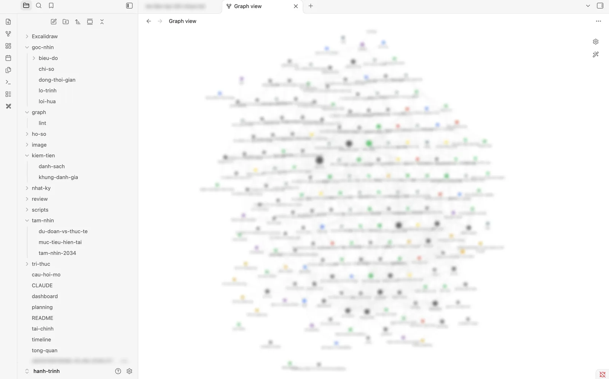

Năm 20 tuổi, tôi viết một bản kế hoạch 10 năm. Sau đó cứ vài tháng tôi lại mở ra viết tiếp: mình đang ở đâu, có bao nhiêu tiền, mục tiêu nào đạt, mục tiêu nào chưa.

Hai năm trôi qua, file đó thành 8 lần check-in. Và tôi bắt đầu không đọc lại nữa. Trong một lần viết, tôi còn tự ghi: _"khá là vội và lười để đọc hết lại từ đầu"_.

Rồi tôi đưa toàn bộ cho AI đọc và hỏi một câu đơn giản: vì sao tiếng Anh của tôi mãi chưa lên?

AI trả lời bằng chính những dòng tôi đã viết, kèm ngày tháng. Có những việc tôi đã hứa, đã làm, mà tôi **không còn nhớ**. Đó là lúc tôi quyết định biến đống nhật ký thành một bộ não thứ hai thật sự.

## Câu trả lời ngắn

**Khi dữ liệu còn nhỏ, bộ não thứ hai không cần vector database hay RAG: một thư mục Markdown có cấu trúc, mỗi thứ một file, cộng một AI đọc được toàn bộ, đã đủ để thấy những pattern bạn không tự thấy.** Phần khó không phải công nghệ, mà là tách tri thức thành các mẩu có quan hệ rõ ràng, và tách bạch điều bạn thật sự cam kết với điều AI gợi ý.

## 1) Vì sao tôi không làm theo kiến trúc "chuẩn"

Tôi tham khảo khoá [Second Brain AI Assistant](https://github.com/decodingai-magazine/second-brain-ai-assistant-course) của Decoding AI. Đó là một hệ thống đầy đủ: nạp dữ liệu từ Notion và crawl hàng trăm link, lưu vào MongoDB, chunk và vector search, fine-tune Llama 3.1 8B để tóm tắt, agent trả lời bằng RAG, đánh giá bằng Opik, điều phối pipeline bằng ZenML.

Rất hay. Nhưng khi tôi đo dữ liệu của mình: **27 file Markdown, khoảng 150 KB**, tất cả do tôi tự viết và tự kiểm chứng.

Với lượng dữ liệu đó, AI đọc hết trong một lần. Vấn đề của tôi không phải _tìm_ thông tin, mà là thông tin nằm lẫn trong văn xuôi, không nối với nhau.

| Thành phần trong khoá học | Bản gọn của tôi               | Khi nào nâng cấp                  |
| ------------------------- | ----------------------------- | --------------------------------- |
| Notion + crawl            | Markdown tự viết              | Khi có từ 2 nguồn tự động trở lên |
| MongoDB                   | Git + file                    | Khi app khác cần truy vấn         |
| Vector search, RAG        | Không cần                     | Khi repo vượt khoảng 1 MB         |
| Agent                     | Claude Code + một file luật   | Khi muốn hỏi từ điện thoại        |
| Opik, ZenML               | Review định kỳ, chạy lệnh tay | Khi có việc chạy tự động          |

Tôi giữ khoá học làm **đích đến dài hạn**, và mỗi bước nâng cấp đều có điều kiện kích hoạt cụ thể. Chưa tới điều kiện thì chưa làm.

## 2) Kiến trúc hiện tại

Nguyên tắc chỉ có một: **Markdown trong git là nguồn sự thật, mọi thứ khác là góc nhìn sinh ra từ đó.** Không database, không server.

```text
Tôi ── "cập nhật: …" ──▶ Claude Code (đọc CLAUDE.md: lệnh + luật)
                              │ sửa đúng nút, rồi chạy script
                              ▼
   tri-thuc/  156 file .md (frontmatter + liên kết [[...]])   ◀── nhat-ky/ (lời văn gốc, không ai sửa)
                              │
           scripts/build_graph.py (Python, chỉ thư viện chuẩn)
           ├─ graph/graph.json   → AI đọc để tra cứu theo quan hệ
           ├─ graph/lint.md      → trễ hạn, link gãy, lời hứa tới hạn, đề xuất chờ duyệt
           └─ goc-nhin/          → dòng thời gian, lộ trình, lời hứa, chỉ số (+ biểu đồ SVG)
                              │
   Obsidian (graph view, backlinks) + Dataview (dashboard.md)
   git → GitHub private (sao lưu)
```

**Các loại nút**, mỗi nút là một file:

| Loại      | Số nút | Ví dụ                                     |
| --------- | ------ | ----------------------------------------- |
| Lời hứa   | 41     | "Hè này all in vào tiếng anh"             |
| Mục tiêu  | 34     | đang chạy, ý định, đã xong, đã bỏ         |
| Mốc       | 20     | những sự kiện đã xảy ra, có ngày          |
| Người     | 13     | ai liên quan tới mục tiêu nào             |
| Điểm mạnh / yếu | 18 | mỗi điểm kèm bằng chứng và cách dùng / cách sửa |
| Dự án, quyết định | 16 | trạng thái, lý do, khi nào xem lại |
| Chỉ số    | 6      | chuỗi số đo theo ngày, tự vẽ biểu đồ      |
| Chặng, tổ chức | 8 | 4 chặng của lộ trình tới năm 30 tuổi       |

Giữa chúng có 457 quan hệ có tên: _thuộc chặng_, _phụ thuộc_, _bị cản bởi_ (điểm yếu), _được hỗ trợ bởi_ (điểm mạnh), _lặp lại của_ (lời hứa cũ), _bằng chứng_ (trỏ về nhật ký). Ví dụ một mục tiêu (minh hoạ):

```yaml
type: muc-tieu
title: "Viết 1 bài blog mỗi tháng"
status: dang-chay
nguon: loc
deadline: 2027-06-30
baseline: 0
current: 2
target: 9
thuoc_chang: "[[chang-1-on-dinh]]"
bi_can_boi: ["[[han-tu-dat-thi-truot]]"]
duoc_ho_tro_boi: ["[[ve-dich-khi-co-han-ngoai]]"]
```

Tiến độ không ghi tay: script và bảng điều khiển tự tính từ `baseline → current → target`, nên không bao giờ lệch.



_Ảnh chụp thật trong Obsidian. Nhãn trên đồ thị đã được làm mờ vì có tên người thật và chuyện riêng._

**AI làm việc qua một file luật.** Tôi gõ `tra cứu: …`, `tiến độ`, `lộ trình`, `cập nhật: …`, `review tuần`. Luật quan trọng nhất: không tự đánh dấu "xong" khi tôi chưa nói, không tự đoán con số, và không biến gợi ý của nó thành cam kết của tôi.

## 3) Tôi đã làm thế nào

Cả quá trình mất khoảng một tuần, còn phần dựng hệ thống gói trong một buổi sáng:

1. **Đưa nhật ký cho AI và trả lời câu hỏi mở.** AI đọc hết rồi hỏi lại những chỗ còn thiếu. Tôi trả lời 4 lượt; mỗi lượt nó cập nhật hồ sơ và chỉ ra chỗ con số mâu thuẫn.
2. **Viết kế hoạch trước khi viết code.** Một file `planning.md` với 7 quyết định thiết kế để tôi chốt: xem bằng Obsidian, mỗi thứ một file trong `tri-thuc/`, nút là nguồn sự thật, tên file không dấu, ghi cả chuyện riêng tư, chỉ commit local rồi đẩy lên repo private.
3. **Tách văn xuôi thành nút.** AI viết một script chạy một lần, biến hồ sơ, mục tiêu, timeline thành 104 nút đầu tiên. Tôi duyệt lại các con số.
4. **Script kiểm tra và bảng điều khiển.** Mỗi lần sửa, script báo link gãy, trường thiếu, việc trễ hạn.
5. **Sửa khi thấy chưa ổn.** Đồ thị chưa giúp được gì, nên thêm dòng thời gian và lộ trình. Kế hoạch quá màu hồng, nên thêm lạm phát và kịch bản. AI ghi nhầm đề xuất thành cam kết, nên thêm trường nguồn gốc.
6. **Thêm lời hứa và chỉ số**, rồi đẩy lên GitHub private. File phiếu điểm có số định danh thì giữ trên máy, không đưa vào git.

## 4) Đồ thị đẹp, nhưng không phải thứ tôi dùng nhiều nhất

Lúc mở graph view lần đầu, tôi thấy… đẹp. Rồi hết. Tôi muốn xem _những gì mình đã trải qua theo thời gian_, và đồ thị không trả lời được câu đó.

Bài học: **đồ thị chủ yếu là để AI đọc, còn người cần những góc nhìn khác.** Tôi thêm:

- **Dòng thời gian**: các mốc đã qua, xếp theo năm.
- **Lộ trình**: biểu đồ gantt 12 tháng tới, việc nào sắp tới hạn thì đỏ.
- **Bảng điều khiển**: tiến độ tính tự động từ con số, không ghi tay.

Đồ thị vẫn có ích ở ba chỗ: xem toàn bộ bối cảnh quanh một người hay một việc trước khi hành động, biết một việc trễ sẽ kéo theo những gì, và để AI lần theo quan hệ khi trả lời.

## 5) Tính năng đáng giá nhất: đếm lời hứa

Câu hỏi về tiếng Anh dẫn tôi tới ý tưởng này: **mỗi lần tôi nói "sẽ làm X trước Y", đó là một nút.** Tới hạn thì chấm: giữ đúng hạn, trễ, một phần hay trượt.

AI đọc lại 8 file nhật ký và tìm được 41 lời hứa. Tôi chia chúng theo một tiêu chí: **hạn do người khác đặt** (trường, công ty, ban tổ chức, ngày thi đã đăng ký) hay **hạn tự đặt** ("hè này", "trong năm nay", "tuần sau").

Kết quả trên 31 lời hứa đã chấm được:

- Hạn bên ngoài: **giữ đúng hạn 77%**.
- Hạn tự đặt: **giữ đúng hạn 11%**.

Mục tiêu tiếng Anh xuất hiện **7 lần**, trượt 5. Có những câu như _"Hè này all in vào tiếng anh"_ mà tôi viết rất quyết tâm, rồi quên mất.

Con số đó đổi cách tôi đặt mục tiêu. Tôi không cần quyết tâm hơn. Tôi cần **biến mọi hạn tự đặt thành hạn bên ngoài**: đóng tiền thi trước, hẹn với một người, cam kết với người đồng hành. Lần duy nhất tôi thật sự đi thi là lần đã có ngày thi cố định.

## 6) Đề xuất của AI không phải lời hứa của bạn

Có một lỗi tôi bắt được khá muộn. Khi tôi trả lời các câu hỏi của AI, nó đề xuất một loạt việc: tách quỹ dự phòng, nghe tiếng Anh trên xe buýt, liên lạc lại một người… Rồi nó ghi những việc đó vào bộ não như thể **tôi đã cam kết**.

Tôi phải nói rõ: "Mấy cái này tôi chưa hứa."

Cách sửa là thêm một trường `nguon` cho mỗi mục tiêu: `loc` (tôi tự đặt), `ai-da-nhan` (AI đề xuất, tôi đã nhận), `ai` (AI đề xuất, tôi chưa nhận). Đề xuất chưa nhận chỉ được ở trạng thái "ý định", và bảng điều khiển có riêng một mục để tôi duyệt.

Nếu bạn để AI ghi vào bộ não của mình, hãy **giữ nguồn gốc của từng dòng**. Không thì sau vài tháng, bạn sẽ không còn phân biệt được đâu là ý mình, đâu là ý máy.

## 7) Bắt AI bớt màu hồng

Bản kế hoạch tài chính đầu tiên AI dựng cho tôi rất đẹp. Quá đẹp. Tôi yêu cầu tính lại với lạm phát và các cú sốc.

Chỉ riêng lạm phát 4%/năm đã làm một mốc thu nhập tôi đặt từ năm 20 tuổi **mất khoảng một phần ba sức mua** sau 10 năm. Thêm các khoản "một lần" mà năm nào cũng có (Tết, đám cưới, thiết bị hỏng, lệ phí thi), số tiền thật sự dư mỗi tháng nhỏ hơn hẳn con số trên giấy.

Giờ mọi kế hoạch tiền trong bộ não đều có 3 kịch bản: xấu, cơ sở, tốt. Tôi lập kế hoạch theo kịch bản cơ sở, phòng thủ cho kịch bản xấu, và coi kịch bản tốt là phần thưởng.

## 8) Kết quả sau một tuần

- **Một bản đồ đầy đủ về chính mình:** 156 nút, 457 quan hệ, mọi con số trỏ về đúng dòng nhật ký đã viết ra nó.
- **Một chẩn đoán thay cho lời tự trách:** câu "vì sao tiếng Anh mãi chưa lên" có 4 nguyên nhân kèm bằng chứng. Ví dụ một kỹ năng đứng yên suốt 21 tháng qua 3 lần thi, và công sức của tôi lại dồn vào kỹ năng khác.
- **Một con số đổi cách đặt mục tiêu:** 77% so với 11%.
- **Ranh giới rõ giữa tôi và AI:** 11 việc AI từng đề xuất đang nằm riêng ở mục "chờ duyệt", không còn lẫn vào việc tôi đang làm.
- **Kế hoạch tiền có lạm phát và 3 kịch bản**, thay cho một con số đẹp.
- **Dòng thời gian, lộ trình, bảng điều khiển** tự cập nhật mỗi khi tôi gõ một dòng `cập nhật:`.

## 9) Lộ trình nâng cấp, và bước tiếp theo trên chính blog này

| Giai đoạn           | Làm gì                                                             | Bật khi nào                                   |
| ------------------- | ------------------------------------------------------------------ | --------------------------------------------- |
| 0. Bản gọn          | Markdown, Obsidian, Dataview, script kiểm tra, lệnh cho AI         | Đã xong                                       |
| 1. Thói quen        | Cập nhật vài dòng mỗi tuần, review cuối tuần                       | Ngay bây giờ                                  |
| 2. Chỉ mục trên máy | SQLite tìm kiếm toàn văn, embedding chạy local, một MCP server nhỏ | Repo vượt khoảng 1 MB, hoặc AI bắt đầu bỏ sót |
| 3. Kiểu khoá học    | Nạp nhiều nguồn, vector search, agent, đánh giá, chạy tự động      | Có từ 2 nguồn tự động trở lên                 |

**Bước tôi muốn làm tiếp: một mục "Hỏi tôi" ngay trên blog này.** Bạn đọc hỏi về hành trình của tôi (tôi học thế nào, chọn việc ra sao, đã sai ở đâu) và AI trả lời từ bộ não thứ hai. Đây mới là kế hoạch, chưa làm. Ba điều kiện tôi đặt ra trước:

- **Chỉ một phần công khai.** Mỗi nút có thêm trường đánh dấu công khai; chỉ những nút tôi đã duyệt mới được xuất sang blog. Lương, tài sản, tên người thật và chuyện riêng không bao giờ rời repo riêng tư.
- **Trả lời có dẫn nguồn**, trỏ về bài viết hoặc mốc cụ thể. Không có nguồn thì nói không biết.
- **Đủ nhỏ để chưa cần RAG.** Phần công khai sẽ nhỏ hơn cả repo hiện tại, nên bắt đầu đơn giản trước, đúng tinh thần của cả hệ thống.

Tôi giới hạn việc bảo trì ở **tối đa 1 giờ mỗi tuần**. Một công cụ để bớt dàn trải mà lại thành dự án phụ thứ ba thì thật trớ trêu.

## Bắt đầu trong một buổi sáng

1. Gom mọi ghi chép về bản thân vào **một thư mục Markdown**, đưa vào git.
2. Chọn 5–6 loại thực thể quan trọng với bạn (mục tiêu, người, dự án…), **mỗi thứ một file**, có vài trường cố định.
3. Mở thư mục bằng **Obsidian**, cài **Dataview**, dựng một bảng mục tiêu đang chạy.
4. Viết một file luật cho AI: nó được sửa gì, không được sửa gì, và **không được tự biến gợi ý thành cam kết của bạn**.
5. Hỏi AI một câu bạn đã né từ lâu.

Việc nhỏ nhất bạn có thể làm ngay hôm nay: **viết ra 5 lời hứa gần nhất bạn từng nói với chính mình**, đánh dấu giữ hay trượt, và đếm xem cái nào có hạn do người khác đặt. Con số đó có thể nói với bạn nhiều hơn bất kỳ bộ công cụ nào.

## Câu hỏi thường gặp

### Xây bộ não thứ hai có cần biết lập trình không?

Phần cốt lõi thì không: một thư mục Markdown, mỗi thứ một file, cộng Obsidian là đủ để xem đồ thị và tra cứu. Biết lập trình chỉ giúp thêm phần tự động như script kiểm tra hay vẽ biểu đồ.

### Khi nào mới cần RAG hay vector database?

Khi dữ liệu lớn đến mức AI không đọc hết được trong một lần, hoặc khi bạn nạp tự động từ nhiều nguồn chưa được kiểm chứng. Với vài chục file nhật ký đã tự viết, vấn đề là cấu trúc chứ không phải truy xuất.

### Nên dùng Notion hay Markdown cho bộ não thứ hai?

Notion tiện để ghi, nhưng Markdown trong git cho bạn toàn quyền dữ liệu, xem được lịch sử thay đổi, và AI hay script nào cũng đọc được trực tiếp. Nếu muốn AI làm việc sâu với dữ liệu, Markdown dễ bắt đầu hơn.

## Nguồn tham khảo

- [Second Brain AI Assistant course, Decoding AI](https://github.com/decodingai-magazine/second-brain-ai-assistant-course)
- [Obsidian](https://obsidian.md)
- [Obsidian Dataview](https://github.com/blacksmithgu/obsidian-dataview)
- [Mermaid: timeline và gantt](https://mermaid.js.org)
